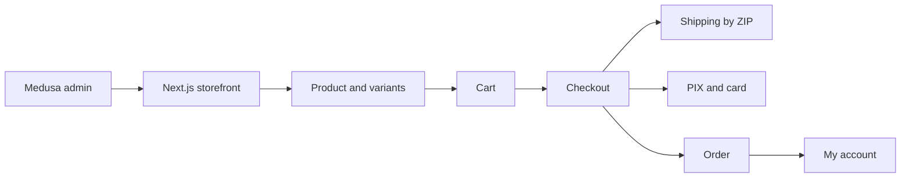
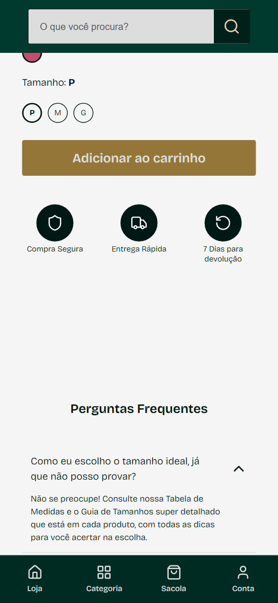
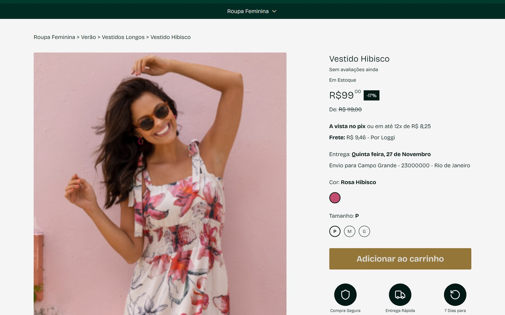
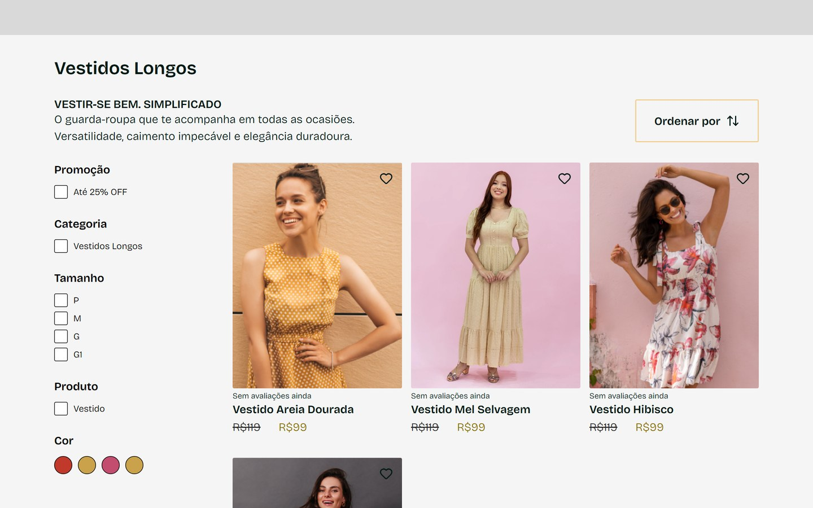
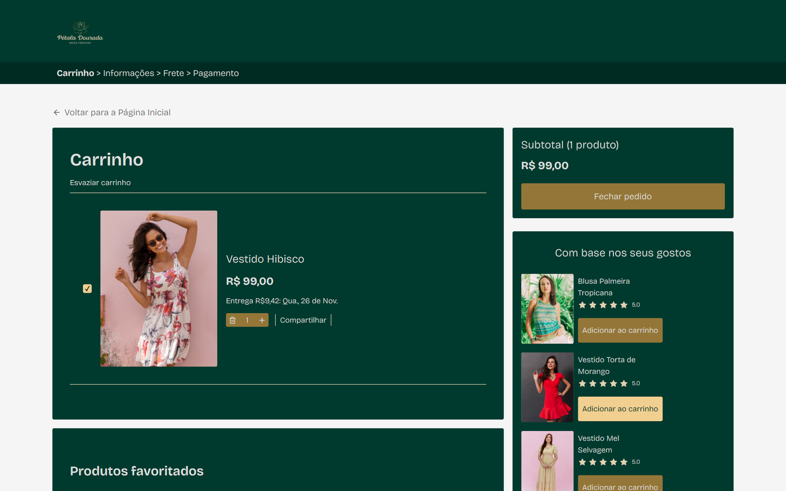
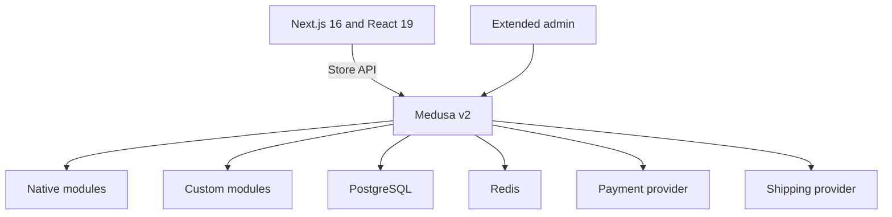

<h1 align="center">Pétala Dourada</h1>

Women's fashion e-commerce, from design to deployment.

  <kbd>&nbsp;&nbsp; Next.js&nbsp;&nbsp;</kbd> &nbsp;<kbd>&nbsp;&nbsp; React&nbsp;&nbsp;</kbd> &nbsp;<kbd>&nbsp;&nbsp; TypeScript&nbsp;&nbsp;</kbd> &nbsp;<kbd>&nbsp;&nbsp; WordPress&nbsp;&nbsp;</kbd> &nbsp;<kbd>&nbsp;&nbsp; WooCommerce&nbsp;&nbsp;</kbd> &nbsp;<kbd>&nbsp;&nbsp; Elementor&nbsp;&nbsp;</kbd>

 &nbsp; 

> The code is private; this repository presents the project. Demo: [dev.petaladourada.com.br](https://dev.petaladourada.com.br).

<table>
<tr>
<td align="center" width="33%"><b>12x</b> installments</td><td align="center" width="33%"><b>PIX and card</b> payments</td><td align="center" width="33%"><b>7 days</b> returns window</td>
</tr>
</table>

### Overview

Pétala Dourada is a women's fashion store. The current version is already live on the demo environment and runs on Next.js and React. The previous store was built on WordPress with WooCommerce and Elementor, and the migration plan calls for a Medusa v2 backend with PostgreSQL.

The rewrite already has the complete front end, from storefront to checkout to the customer account, still fed by sample data. The architecture document (PLANO-MEDUSA, in Markdown and HTML) defines how each page will read data from Medusa. The backend hasn't been written yet.

### How it works

The flow below describes the new store the way the plan lays it out.

1. The customer browses the storefront: home, categories, search and product. Next.js reads products, categories and prices through the Medusa Store API.
2. On the product page, she picks color and size. Each combination is a variant with its own price and stock, and changing color changes the photo gallery.
3. She adds it to the bag. The cart becomes the Medusa Cart, replacing today's local storage.
4. At checkout, she enters details and address, picks shipping by ZIP code and pays with PIX or card.
5. The order is created, and she tracks status, shipping, exchanges and returns in My account.
6. The store owner edits catalog, home, banners and content in the Medusa admin panel, with no code changes.

### Features in detail

#### Catalog and product

The catalog is organized by categories that can have subcategories, created in the admin, with no fixed tree. The product page brings together gallery, price with "from/to", installments, color, size, shipping, stock and reviews.

 Size selection and buy button on mobile.

 Product page: discounted price, installments, shipping, color and size.

 Long Dresses category, with promotion, size and color filters and "from/to" prices.

 Store home: header with search, main banner, promo strip and trust badges.

- Category, tag and collection are native to Medusa and filter the listings (products, categories, new arrivals, search).
- Color and size are product options. Color stores its hexadecimal code in metadata to paint the swatch, and the admin gains a color picker.
- Only published products appear on the storefront, and availability is tied to a sales channel.
- The sold-out status comes from per-variant stock.
- The plan covers 11 products for now, with a SKU per product and per variant.

#### Reviews

Medusa has no reviews, so the plan creates a custom module. Each review has a rating, author, text, criteria and a moderation status (pending, approved, rejected).

- Moderation happens on an admin screen.
- The recorded decision is to unlock a review only after the order is delivered.

#### Cart and checkout

Checkout follows the steps bag, details, shipping, payment and success. The cart interface stays the same, and only the data source changes.

 Cart with one item, subtotal, delivery estimate and product suggestions.

- The maximum installment count (for example 12x) is a store setting.
- Shipping by ZIP code comes from Medusa shipping options. The plan calls for a custom provider connected to the Entrega Fácil API.
- Paying with PIX and card needs a custom provider, because Medusa ships no PIX. The recorded decision is to integrate the InfinitePay API.
- The success page reads the real order created when the cart completes.

#### Customer account

The account area covers orders, favorites, addresses, profile, preferences, privacy and returns.

- Login works with email and password or with Google, and sign-up requires email verification.
- Orders and returns come from Medusa's Order and Return modules, which supports exchanges and returns.
- Favorites do not exist in Medusa, so they become a custom module linked to customer and product.
- The privacy screen plans data export and deletion, with a grace period before deletion.

#### Editable admin

The core idea of the plan is that almost everything is editable from the Medusa panel, through new screens and components injected into product screens.

- The home becomes an ordered list of sections (banner, carousel, grid, looks, promo strip, trust badges, FAQ) that the owner turns on, off and reorders.
- Each banner has one image for desktop and one for mobile. The admin shows the real dimensions and the expected crop per screen.
- Looks, FAQ, trust badges, menus and institutional pages have their own screens.
- Coupons use the promotions module, with an end date and a usage limit.

### Architecture and stack

The existing Next.js front end becomes the storefront. Medusa provides commerce, and custom modules provide the store's content.

- The native modules are product, pricing, inventory, cart, order, customer, auth, payment, fulfillment, promotions and notifications.
- The custom modules are homepage, banner, look, review, wishlist, content, store_settings and product_extra, linked to the catalog through module links.
- Redis is recommended for workflows, events and cache, and transactional email uses Resend.
- The store has a single region (Brazil), a single currency (BRL) and one sales channel.

### Engineering decisions

- **Move to headless Medusa.** The goal stated in the plan is that the owner edits almost everything without touching code. Medusa provides commerce out of the box (product, stock, cart, order, payment, shipping) and leaves the front end free for the custom content layer.
- **Keep the front end already faithful to the design.** Medusa's official starter was dropped, and the existing Next.js only swaps its sample data files for Store API calls.
- **Editable content through custom modules.** What the store needs and Medusa lacks (home, banners, looks, reviews, favorites) becomes a module with admin screens.
- **Migrate in phases.** Catalog and storefront come first, because they do not depend on a gateway. Then reviews, accounts, cart and orders, payment and shipping, and finally promotions, emails and go-live.
- **Temporary, isolated infrastructure.** The instance starts with a dedicated Postgres, as a temporary setup, to be moved later to the final VPS.

### Known limits

- The plan is dated 2026-06-01 and records that no backend code had been written at that date.
- Payment (InfinitePay) and shipping (Entrega Fácil) depend on documentation, credentials and product dimensions.
- Automatic invoice issuing is open: the government API still has to be chosen and an A1 digital certificate obtained.
- Translating the native admin to Portuguese was still listed as research to do.
- Analytics (GA4 and Meta Pixel) and accepting both CPF and CNPJ in the same sign-up were marked as to be confirmed.
- The 7-day window for exchanges and returns does not appear in the plan files.
- WhatsApp is marked "coming soon", and only the contact opt-in exists.

Contact: <a href="https://joaocouto.alcetus.com">joaocouto.alcetus.com</a> · <a href="mailto:joaopecouto77@gmail.com">joaopecouto77@gmail.com</a>
