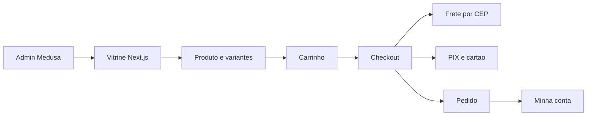
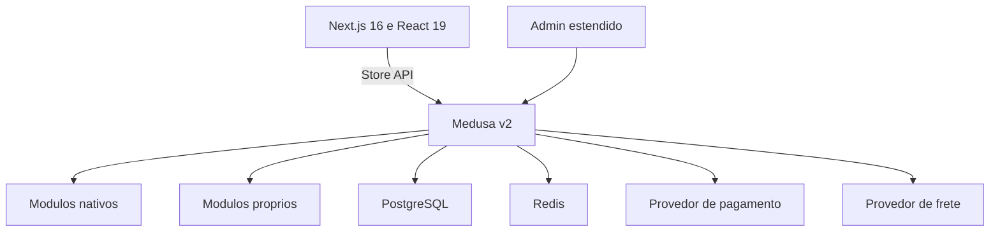
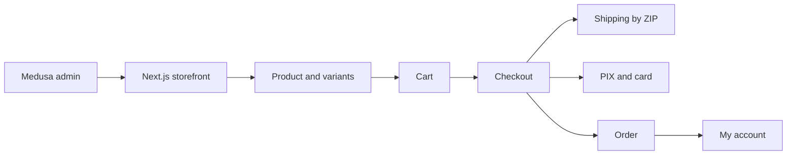
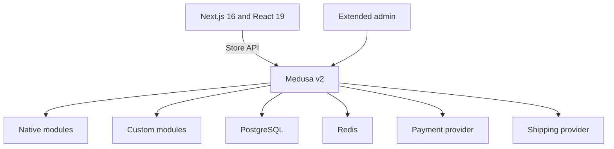

<h1 align="center">Pétala Dourada</h1>

E-commerce de moda feminina, do design ao deploy. <i>Women's fashion e-commerce, from design to deployment.</i>

  <kbd> Next.js</kbd> <kbd> React</kbd> <kbd> TypeScript</kbd> <kbd> WordPress</kbd> <kbd> WooCommerce</kbd> <kbd> Elementor</kbd>

<a href="#portugu%C3%AAs"><b>Português</b></a> &nbsp;|&nbsp; <a href="#english"><b>English</b></a>

> **PT** O código é privado; este repositório apresenta o projeto. Demo: [dev.petaladourada.com.br](https://dev.petaladourada.com.br).
> **EN** The code is private; this repository presents the project. Demo: [dev.petaladourada.com.br](https://dev.petaladourada.com.br).

## Português

<table>
<tr>
<td align="center" width="33%"><b>12x</b> parcelamento</td><td align="center" width="33%"><b>PIX e cartão</b> pagamentos</td><td align="center" width="33%"><b>7 dias</b> trocas e devoluções</td>
</tr>
</table>

### Visão geral

A Pétala Dourada é uma loja de moda feminina. A versão atual está no ar no ambiente de demonstração e roda em Next.js e React. A loja anterior foi feita em WordPress com WooCommerce e Elementor, e o plano de migração prevê um backend Medusa v2 com PostgreSQL.

A reescrita já tem o front-end completo, da vitrine ao checkout e à conta da cliente, ainda alimentado por dados de exemplo. O documento de arquitetura (PLANO-MEDUSA, em Markdown e em HTML) define como cada página passa a ler dados do Medusa. O backend ainda não foi escrito.

### Como funciona

O fluxo abaixo descreve a loja nova, como o plano a desenha.

1. A cliente navega pela vitrine: home, categorias, busca e produto. O Next.js lê produtos, categorias e preços pela Store API do Medusa.
2. No produto, ela escolhe cor e tamanho. Cada combinação é uma variante com preço e estoque próprios, e trocar a cor troca a galeria de fotos.
3. Ela adiciona à sacola. O carrinho passa a ser o Cart do Medusa, no lugar do armazenamento local atual.
4. No checkout, informa dados e endereço, escolhe o frete por CEP e paga com PIX ou cartão.
5. O pedido é criado, e a cliente acompanha status, rastreio, trocas e devoluções em Minha conta.
6. A dona da loja edita catálogo, home, banners e conteúdo no painel admin do Medusa, sem mexer em código.

### Funcionalidades em detalhe

#### Catálogo e produto

O catálogo é organizado por categorias que podem ter subcategorias, criadas no admin, sem árvore fixa. A página de produto reúne galeria, preço com "de/por", parcelas, cor, tamanho, frete, estoque e avaliações.

 Seleção de tamanho e botão de compra na versão mobile.

 Página de produto: preço com desconto, parcelas, frete, cor e tamanho.

 Categoria Vestidos Longos, com filtros de promoção, tamanho e cor e preço "de/por".

 Home da loja: cabeçalho com busca, banner principal, faixa promocional e selos de garantia.

- Categoria, tag e coleção são nativos do Medusa e filtram as listagens (produtos, categorias, novidades, busca).
- Cor e tamanho são opções do produto. A cor guarda o código hexadecimal em metadados para pintar a amostra, e o admin ganha um seletor de cor.
- Só produtos publicados aparecem na vitrine, e a disponibilidade fica amarrada a um canal de venda.
- Esgotado vem do estoque por variante.
- O plano prevê 11 produtos por enquanto, com SKU por produto e por variante.

#### Avaliações

O Medusa não traz avaliações, então o plano cria um módulo próprio. Cada avaliação tem nota, autor, texto, critérios e um status de moderação (pendente, aprovada, rejeitada).

- A moderação acontece em uma tela do admin.
- A decisão registrada é liberar a avaliação só depois que o pedido for entregue.

#### Carrinho e checkout

O checkout segue as etapas sacola, informações, frete, pagamento e sucesso. A interface do carrinho continua igual, e só muda a fonte dos dados.

 Carrinho com um item, subtotal, previsão de entrega e sugestões de produtos.

- O parcelamento máximo (por exemplo 12x) é uma configuração da loja.
- O frete por CEP vem de opções de envio do Medusa. O plano prevê um provedor próprio ligado à API da Entrega Fácil.
- O pagamento por PIX e cartão exige um provedor próprio, porque o Medusa não traz PIX. A decisão registrada é integrar a API da InfinitePay.
- A tela de sucesso passa a ler o pedido real criado ao concluir o carrinho.

#### Conta da cliente

A área de conta cobre pedidos, favoritos, endereços, perfil, preferências, privacidade e devoluções.

- Login com e-mail e senha e com Google, com verificação de e-mail obrigatória no cadastro.
- Pedidos e devoluções vêm dos módulos Order e Return do Medusa, o que sustenta trocas e devoluções.
- Favoritos não existem no Medusa, então viram um módulo próprio ligado ao cliente e ao produto.
- A tela de privacidade prevê exportar e excluir dados, com uma carência para a exclusão.

#### Admin editável

A ideia central do plano é que quase tudo seja editável pelo painel do Medusa, com telas novas e componentes injetados nas telas de produto.

- A home vira uma lista ordenada de seções (banner, carrossel, grade, looks, faixa promocional, garantias, FAQ), que a dona liga, desliga e reordena.
- Cada banner tem uma imagem para desktop e outra para celular. O admin mostra as dimensões reais e o corte previsto por tela.
- Looks, FAQ, garantias, menus e páginas institucionais têm telas próprias.
- Cupons usam o módulo de promoções, com data final e limite de uso.

### Arquitetura e stack

O front-end Next.js existente vira o storefront. O Medusa entrega o comércio e módulos próprios entregam o conteúdo da loja.

- Módulos nativos: produto, preço, estoque, carrinho, pedido, cliente, autenticação, pagamento, frete, promoções e notificações.
- Módulos próprios: homepage, banner, look, review, wishlist, content, store_settings e product_extra, ligados ao catálogo por links entre módulos.
- Redis é recomendado para workflows, eventos e cache. E-mails transacionais usam o Resend.
- Região única (Brasil), moeda única (BRL) e um canal de venda.

### Decisões de engenharia

- **Migrar para Medusa headless.** O objetivo declarado no plano é que a dona edite quase tudo sem mexer em código. O Medusa entrega o comércio pronto (produto, estoque, carrinho, pedido, pagamento, frete) e deixa o front-end livre para a camada de conteúdo própria.
- **Manter o front-end já fiel ao design.** O starter oficial do Medusa foi descartado, e o Next.js existente só troca os arquivos de dados de exemplo por chamadas à Store API.
- **Conteúdo editável por módulos próprios.** O que a loja precisa e o Medusa não tem (home, banners, looks, avaliações, favoritos) vira módulo com telas no admin.
- **Migrar por fases.** Catálogo e vitrine vêm primeiro, porque não dependem de gateway. Depois vêm avaliações, contas, carrinho e pedidos, pagamento e frete, e por fim promoções, e-mails e entrada no ar.
- **Infra temporária e isolada.** A instância nasce com Postgres dedicado, em caráter temporário, para ser movida depois para a VPS final.

### Limites conhecidos

- O plano é de 2026-06-01 e registra que nenhuma linha de backend foi escrita naquela data.
- O pagamento (InfinitePay) e o frete (Entrega Fácil) dependem de documentação, credenciais e dimensões dos produtos.
- A emissão automática de nota fiscal está em aberto: falta definir qual API do governo e obter certificado digital A1.
- A tradução do admin nativo para português ainda estava como pesquisa a fazer.
- Analytics (GA4 e Meta Pixel) e a aceitação de CPF e CNPJ no mesmo cadastro estavam marcados como a confirmar.
- O prazo de 7 dias para trocas e devoluções não aparece nos arquivos do plano.
- WhatsApp fica como "em breve", apenas com o aceite de contato.

## English

<table>
<tr>
<td align="center" width="33%"><b>12x</b> installments</td><td align="center" width="33%"><b>PIX and card</b> payments</td><td align="center" width="33%"><b>7 days</b> returns window</td>
</tr>
</table>

### Overview

Pétala Dourada is a women's fashion store. The current version is live on the demo environment and runs on Next.js and React. The previous store was built on WordPress with WooCommerce and Elementor, and the migration plan calls for a Medusa v2 backend with PostgreSQL.

The rewrite already has the complete front end, from storefront to checkout to the customer account, still fed by sample data. The architecture document (PLANO-MEDUSA, in Markdown and HTML) defines how each page will read data from Medusa. The backend has not been written yet.

### How it works

The flow below describes the new store as the plan designs it.

1. The customer browses the storefront: home, categories, search and product. Next.js reads products, categories and prices through the Medusa Store API.
2. On the product page, she picks color and size. Each combination is a variant with its own price and stock, and changing color changes the photo gallery.
3. She adds it to the bag. The cart becomes the Medusa Cart, replacing today's local storage.
4. At checkout, she enters details and address, picks shipping by ZIP code and pays with PIX or card.
5. The order is created, and she tracks status, shipping, exchanges and returns in My account.
6. The store owner edits catalog, home, banners and content in the Medusa admin panel, with no code changes.

### Features in detail

#### Catalog and product

The catalog is organized by categories that can have subcategories, created in the admin, with no fixed tree. The product page brings together gallery, price with "from/to", installments, color, size, shipping, stock and reviews.

 Size selection and buy button on mobile.

 Product page: discounted price, installments, shipping, color and size.

 Long Dresses category, with promotion, size and color filters and "from/to" prices.

 Store home: header with search, main banner, promo strip and trust badges.

- Category, tag and collection are native to Medusa and filter the listings (products, categories, new arrivals, search).
- Color and size are product options. Color stores its hexadecimal code in metadata to paint the swatch, and the admin gains a color picker.
- Only published products appear on the storefront, and availability is tied to a sales channel.
- Sold out comes from per-variant stock.
- The plan covers 11 products for now, with a SKU per product and per variant.

#### Reviews

Medusa has no reviews, so the plan creates a custom module. Each review has a rating, author, text, criteria and a moderation status (pending, approved, rejected).

- Moderation happens on an admin screen.
- The recorded decision is to unlock a review only after the order is delivered.

#### Cart and checkout

Checkout follows the steps bag, details, shipping, payment and success. The cart interface stays the same, and only the data source changes.

 Cart with one item, subtotal, delivery estimate and product suggestions.

- The maximum installment count (for example 12x) is a store setting.
- Shipping by ZIP code comes from Medusa shipping options. The plan calls for a custom provider connected to the Entrega Fácil API.
- Paying with PIX and card needs a custom provider, because Medusa ships no PIX. The recorded decision is to integrate the InfinitePay API.
- The success page reads the real order created when the cart completes.

#### Customer account

The account area covers orders, favorites, addresses, profile, preferences, privacy and returns.

- Email and password login plus Google, with mandatory email verification at sign-up.
- Orders and returns come from Medusa's Order and Return modules, which supports exchanges and returns.
- Favorites do not exist in Medusa, so they become a custom module linked to customer and product.
- The privacy screen plans data export and deletion, with a grace period before deletion.

#### Editable admin

The core idea of the plan is that almost everything is editable from the Medusa panel, through new screens and components injected into product screens.

- The home becomes an ordered list of sections (banner, carousel, grid, looks, promo strip, trust badges, FAQ) that the owner turns on, off and reorders.
- Each banner has one image for desktop and one for mobile. The admin shows the real dimensions and the expected crop per screen.
- Looks, FAQ, trust badges, menus and institutional pages have their own screens.
- Coupons use the promotions module, with an end date and a usage limit.

### Architecture and stack

The existing Next.js front end becomes the storefront. Medusa provides commerce, and custom modules provide the store's content.

- Native modules: product, pricing, inventory, cart, order, customer, auth, payment, fulfillment, promotions and notifications.
- Custom modules: homepage, banner, look, review, wishlist, content, store_settings and product_extra, linked to the catalog through module links.
- Redis is recommended for workflows, events and cache. Transactional email uses Resend.
- A single region (Brazil), a single currency (BRL) and one sales channel.

### Engineering decisions

- **Move to headless Medusa.** The goal stated in the plan is that the owner edits almost everything without touching code. Medusa provides commerce out of the box (product, stock, cart, order, payment, shipping) and leaves the front end free for the custom content layer.
- **Keep the front end already faithful to the design.** Medusa's official starter was dropped, and the existing Next.js only swaps its sample data files for Store API calls.
- **Editable content through custom modules.** What the store needs and Medusa lacks (home, banners, looks, reviews, favorites) becomes a module with admin screens.
- **Migrate in phases.** Catalog and storefront come first, because they do not depend on a gateway. Then reviews, accounts, cart and orders, payment and shipping, and finally promotions, emails and go-live.
- **Temporary, isolated infrastructure.** The instance starts with a dedicated Postgres, as a temporary setup, to be moved later to the final VPS.

### Known limits

- The plan is dated 2026-06-01 and records that no backend code had been written at that date.
- Payment (InfinitePay) and shipping (Entrega Fácil) depend on documentation, credentials and product dimensions.
- Automatic invoice issuing is open: the government API still has to be chosen and an A1 digital certificate obtained.
- Translating the native admin to Portuguese was still listed as research to do.
- Analytics (GA4 and Meta Pixel) and accepting both CPF and CNPJ in the same sign-up were marked as to be confirmed.
- The 7-day window for exchanges and returns does not appear in the plan files.
- WhatsApp is marked "coming soon", with opt-in only.

Contato · Contact: <a href="https://joaocouto.alcetus.com">joaocouto.alcetus.com</a> · <a href="mailto:joaopecouto77@gmail.com">joaopecouto77@gmail.com</a>
