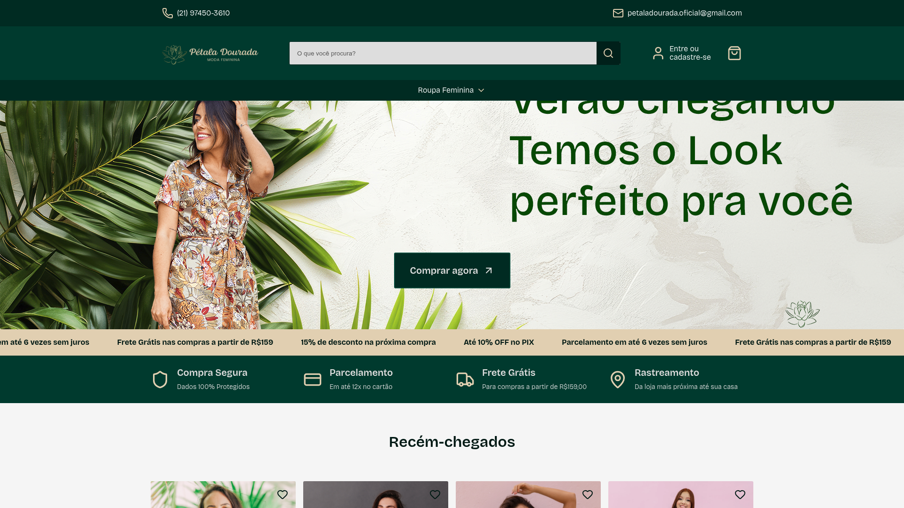

<h1 align="center">Pétala Dourada — E-commerce</h1>

  Loja de moda feminina: e-commerce completo, do design ao deploy. 
  <i>Women's fashion e-commerce: a full store, from design to deployment.</i>

  
  

> 📌 **Estudo de caso / Case study.** O código é privado; este repositório é a vitrine do projeto.

---

## 🇧🇷 Português

### Sobre
Loja online da marca **Pétala Dourada** (moda feminina, Rio de Janeiro) — catálogo, carrinho, checkout, contas de cliente, rastreamento e páginas institucionais.

### Funcionalidades
- 🛍️ Catálogo por categorias (Blusas, Vestidos, Saias, Shorts) e página de produto com variantes (cor/tamanho), estoque e avaliações
- 🛒 Carrinho, checkout, **parcelamento até 12x**, frete por CEP e rastreamento
- 👤 Contas: pedidos, favoritos, endereços, trocas/devoluções (7 dias)
- 🎯 Home com hero, faixas promocionais, **trust badges** (compra segura, frete grátis, etc.) e vitrine de recém-chegados

### Stack
- **Loja em produção:** WordPress + WooCommerce + Elementor
- **Reescrita (em desenvolvimento):** **Next.js 16 + React 19** (TypeScript) com backend **Medusa v2 + PostgreSQL**
- **Infra:** Docker · pagamentos via PIX/cartão

---

## 🇺🇸 English

**About.** Online store for the **Pétala Dourada** women's fashion brand (Rio de Janeiro) — catalog, cart, checkout, customer accounts, tracking and content pages.

**Highlights**
- 🛍️ Category catalog + product pages with variants, stock and reviews
- 🛒 Cart, checkout, installments, shipping by ZIP, order tracking
- 👤 Accounts: orders, wishlist, addresses, returns
- 🎯 Hero, promo bars, trust badges, new-arrivals showcase

**Stack:** WordPress + WooCommerce + Elementor (live) · being rebuilt with **Next.js 16 + React 19** and a **Medusa v2 + PostgreSQL** backend · Docker.

---

🖼️ Mais telas (catálogo, produto, checkout) em breve. · More screens coming soon.
